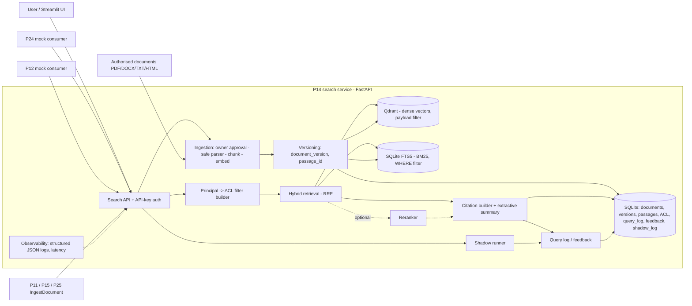

# Architecture (draft)

## High-level view

Notes:
- BM25 lives in SQLite FTS5 (ADR-004): no extra service, persistent, same database as metadata and ACL.
- The ACL filter is built once from the principal and applied **inside** both retrievers (Qdrant payload filter, FTS5 WHERE clause), never as a post-filter, so unauthorised passages cannot influence counts or scores.
- The shadow runner executes B0 and the candidate system on the same query, shows only B0 to the user and logs both (see EVALUATION.md).
- Stretch components (not in the diagram): related-documents endpoint, CloudEvents publisher, local LLM summary, MCP wrapper.

## Access control model
- `access_level` in {public, internal, restricted} plus `office`, stored per document and copied to every passage.
- Principal = API key per consumer, mapped (in configuration) to a role and a list of offices. No real identity provider: this is a declared limitation.
- Rules: public -> everyone; internal -> any authenticated internal principal; restricted -> principals whose offices include the document's office.
- P24 (external assistant) is mapped to `public` only; this is part of the contract.
- An automated leakage test checks, for every principal, that no returned passage exceeds its level.

## Identifiers and versions
- `document_id`: stable id of the source (`source_id` + canonical path/URI), independent of content.
- `document_version`: SHA-256 of the document content.
- `passage_id`: hash of (`document_id`, `document_version`, `chunker_version`, start offset).
- Unchanged content re-indexed with the same chunker keeps the same ids. A new `chunker_version` changes passage ids in a declared way.
- Old versions remain resolvable read-only. Deleted documents -> tombstone `410 Gone` (documented in the contract; not implemented in the MVP).

## Traceability data (query_log)
`request_id`, timestamp, pseudonymised principal, query, filters, version block (pipeline, chunker, embedding model, reranker, index snapshot), returned `passage_id`s with score and rank, `insufficient_evidence`, latency, linked feedback.
Scores are exposed as `evidence`, not as "confidence": retrieval scores are not calibrated probabilities. Retention period and minimisation rules: see SECURITY_OVERSIGHT.md.

## Diagrams to produce
| Diagram | Priority | Why |
|---|---|---|
| System context | Essential | Shows P14 among users and other puzzle pieces |
| Component diagram | Essential | Deliverable 1 (architecture) |
| Sequence: ingestion (with owner approval) | Essential | Explains the indexing pipeline and the oversight point |
| Sequence: search (ACL filter, fusion, citations, logging) | Essential | Explains retrieval and traceability |
| Data model (ER) | Essential | Persistent document/passage ids are part of the contract |
| Integration diagram | Essential | Deliverable 7 (two connections) |
| Sequence: shadow mode | Useful | Deliverable 8 (validation before automation) |
| Data flow diagram | Useful | Privacy / data minimisation discussion |

Diagrams live in docs/diagrams/ as Mermaid (.mmd) sources.
